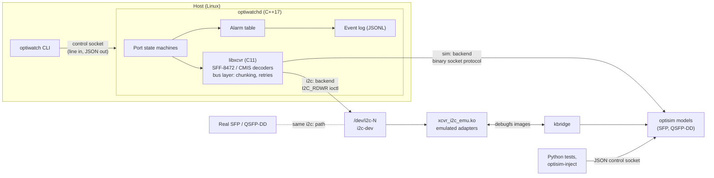
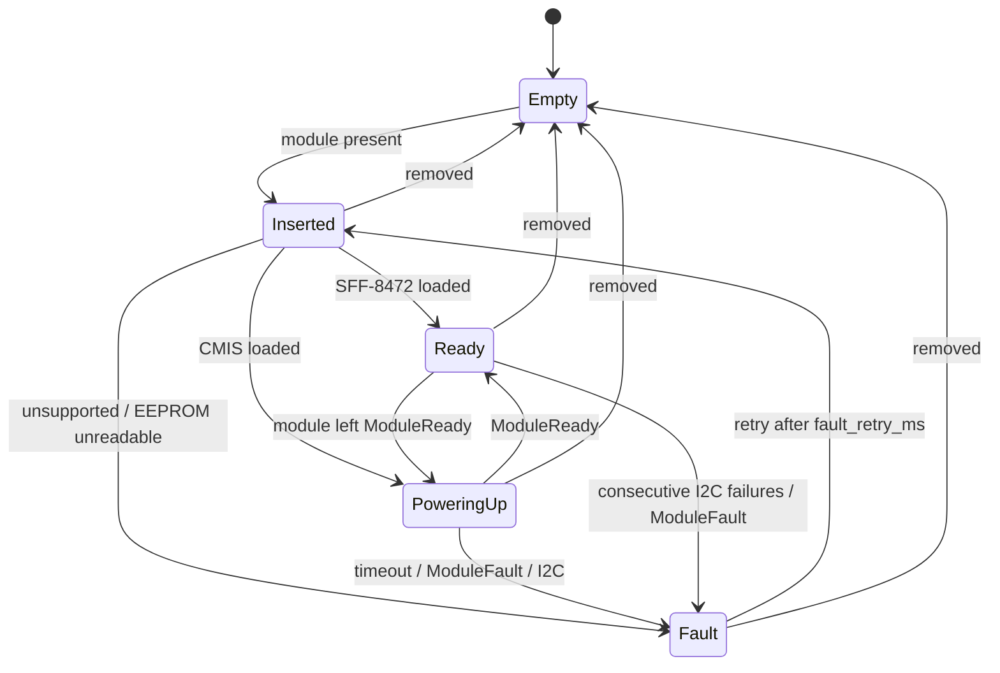

# Architecture



The same daemon binary runs in three setups that differ only in the bus
spec of each port:

| Setup | Bus spec | Used by |
|-------|----------|---------|
| Simulator over a socket | `sim:/tmp/optisim.sock:N` | development, `make itest` |
| Kernel emulator through i2c-dev | `i2c:/dev/i2c-N` | `tests/kernel`, CI kernel job |
| Real hardware | `i2c:/dev/i2c-N` | a board with SFP/QSFP cages |

## libxcvr (C11, `lib/`, `include/xcvr/`)

Three layers, each testable without the one above it.

1. **Bus** (`bus.c`, `bus_*.c`). A small vtable (`read`, `write`,
   `present`, `close`) with three backends. The generic layer on top:
   * splits transfers into `max_xfer` chunks that never cross offset 128,
     because both SFF-8472 and CMIS page at 128 and many host adapters
     limit transfer size;
   * retries failed transactions with linear backoff, but never retries a
     NACK on the address (`-ENXIO`), which means "no module";
   * counts reads, writes, bytes, retries and errors per bus.
2. **Decoders** (`sff8472.c`, `cmis.c`). Pure functions from raw byte
   images to `xcvr_info`, `xcvr_threshold_set` and `xcvr_dom` in
   engineering units. No I/O, which is what makes the 23 C unit tests
   cheap and exhaustive.
3. **Module** (`module.c`). Knows which bytes to fetch: the full static
   maps once at insertion, then only the live registers on each poll (24
   bytes on an SFP, 32 + 8 + 74 bytes over two pages on a CMIS module).
   Also implements TX disable, LowPwr control and verified page select.

## optiwatchd (C++17, `daemon/`)

Single-threaded event loop (`main.cpp`): `poll()` over a `signalfd`, the
control socket listener and its clients, with the timeout set to the
earliest time any port has work due. Signals are only handled between
I2C transactions.

### Port state machine (`port.cpp`)



* Presence comes from the backend (`MOD_ABS` in the simulator) or, on
  i2c-dev, from probing byte 0 at 0x50. Only a NACK counts as absent.
* After insertion the port waits `insert_settle_ms` before touching the
  EEPROM, like a real host waits for the module to finish its own reset.
* An unsupported module is a permanent fault: no retries until it is
  pulled.

### Alarm model (`alarm.cpp`, `Port::evaluate_alarms`)

* Identity is `(port, type, lane)`. Raising an active alarm only refreshes
  its value; every raise and clear is one event.
* Severities follow ITU-T X.733: LOS, Tx fault and ModuleFault are
  critical; threshold alarms, I2C failure and power-up timeout are major;
  threshold warnings, checksum and unsupported module are minor.
* Threshold evaluation is done by the daemon from the module's own
  thresholds (not from the module's flags), so it can add hysteresis:
  an alarm raises when the value crosses the limit and clears only when it
  is back inside by the configured margin. Optical power is compared in
  dBm, so the margin is in dB.
* Correlation rules:
  * an alarm supersedes the warning on the same side;
  * Tx bias and Tx power alarms are suppressed on lanes the host disabled;
  * low Rx power alarms are suppressed while the lane has LOS (LOS is the
    root cause).
* Removing a module clears its alarms with reason `module_removed`.

### Automatic laser shutdown

With `als = true` on a port, a lane that reports Rx LOS gets its
transmitter disabled (`als_shutdown` event) and re-enabled when light
returns (`als_restore`). An operator `tx-disable ... off` overrides it.

### Interfaces

* **Event log**: JSON lines, append-only, reopened on `SIGHUP` for log
  rotation. The last 512 events are also kept in memory for `events N`.

  ```json
  {"seq":12,"ts":"2026-11-24T21:19:34.623Z","port":"p1","event":"alarm_raised","alarm":"rx_los","lane":3,"severity":"critical","message":"Loss of signal"}
  ```

* **Control socket**: one command per line, one JSON object per line back.
  `ports`, `port NAME`, `alarms [NAME]`, `events [N]`, `stats`,
  `tx-disable NAME LANES on|off`, `show ports|port NAME|alarms`. Up to 16
  clients; extra clients get an error and are closed.

## optisim (Python, `sim/optisim/`)

* `sff8472.py`, `cmis.py`: module models whose maps are rendered from
  engineering values on every read, with the module-side behaviour the
  daemon depends on: read-only serial ID, soft TX disable, CMIS page select
  that rejects unsupported pages, the LowPwr, PwrUp, Ready state machine,
  clear-on-read latched flags, dark lanes outside ModuleReady.
* `server.py`: a chassis of cages behind two sockets. The I2C protocol is
  5-byte requests (`op port addr offset len`) and a status byte reply (an
  errno, so `6` is a NACK). The control protocol is JSON lines.
* `inject.py`: CLI for the control socket, including canned scenarios
  (`overheat`, `fiber-cut`, `flaky-bus`, `hot-swap`).

## xcvr_i2c_emu (kernel, `kernel/`)

Registers one `i2c_adapter` per cage with an `xfer` callback that behaves
like a module's EEPROM: a write message sets the register pointer (and
writes data to host-writable registers only), a read message streams bytes
from the pointer. CMIS mode serves the upper half from the page selected in
byte 127 and clears latched flag bytes on read. Faults (`nack`,
`error_every`) are injected in the transfer path, so the daemon sees real
`-ENXIO` / `-EIO` from the ioctl.

Images are loaded through debugfs by `kbridge`, which also copies host
writes (soft TX disable, LowPwr, lane disable) back into the Python models.
Reloading an image keeps host-owned bytes so a refresh cannot undo a
write that raced it.

## Testing

| Suite | Where | What |
|-------|-------|------|
| C unit (23 tests) | `tests/unit` | decoders, calibration, checksums, paging, bus chunking and retries |
| Simulator (22 tests) | `tests/sim` | model behaviour and both socket protocols |
| Integration (29 tests) | `tests/integration` | the daemon binary against the simulator, one fault per test |
| Kernel (6 tests) | `tests/kernel` | the daemon over `/dev/i2c-N` and the kernel module |

CI runs everything with gcc and clang, again under ASan + UBSan, runs
cppcheck, and builds, loads and tests the kernel module on the runner.

## Limitations and next steps

* SFF-8636 (QSFP+/QSFP28) is detected but not managed.
* CMIS banks other than 0 and the data path state machine (DPInit,
  DPDeactivated per application) are not driven; lanes are treated as
  active once the module is Ready.
* Polling only. A real board would use the module's `IntL` line to poll
  latched flags on interrupt.
* One thread polls every port. With many cages on slow buses, a worker per
  bus (or per I2C mux) would keep one slow module from delaying the rest.
* ALS implements the per-lane shutdown decision, not the timed restart
  pulses of the full G.664 procedure.
